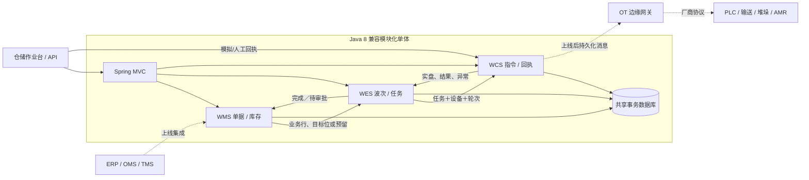
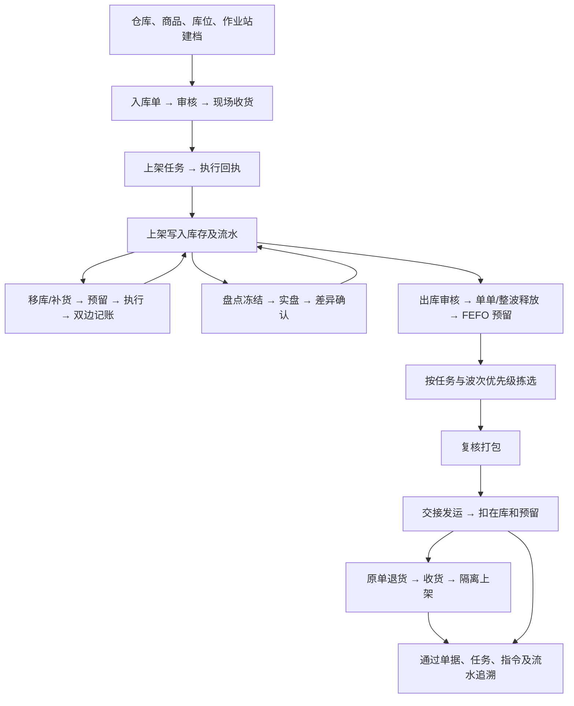

# Stone WMS + WES + WCS 概要设计

## 产品定位与职责

面向常温托盘、整件、料箱混合作业仓。每个 SKU 采用一个基本计量单位和整数数量，按批次追溯。ERP/OMS 提供采购、销售、退货需求，TMS 提供运输计划。现场由收货员验货，库存主管审核单据与差异，计划员编排波次，班组长分派任务，作业员报工，复核员确认打包和交接，设备工程师核对异常货物位置。

| 系统 | 数据与决策 | 输入 | 输出 |
| --- | --- | --- | --- |
| WMS | 商品、库位、批次、出入库单、库存余额与流水 | 业务需求、验收、实盘 | 任务需求、业务状态、库存结果 |
| WES | 波次、任务拆分与排序、派发、异常核对 | 已审批订单、预留、设备状态 | 指令请求、作业进度与结果 |
| WCS | 设备单槽、执行轮次、指令与回执 | 任务执行请求 | 进度、故障原因或实际完成 |
| 现场控制 | PLC、安全回路、动作与互锁 | 厂商协议及控制字 | 心跳、位置、告警、完成信号 |

Spring Boot 2.7、Spring MVC、MyBatis、H2 与静态 Web 界面构成默认运行环境。Web 层接收请求、应用层编排事务、领域层定义库存和状态概念，基础设施借助 MyBatis 实现仓储端口。MyBatis 映射数据库列到领域对象，响应显式挑选业务字段。MySQL 5.7 为 SQL 兼容目标，另有连接配置。

## 仓内全链路和落账

- 上架成功才增加目标库位在库。普通入库按验收量建单，退货按原出库批次和发运量控制。
- 出库释放时预留。拣出的实物进入线下暂存，账上仍记原库位并保留预留；发运才扣减，退拣取消须先确认实物回原位。
- 移库、补货在同一事务扣源位、增目标位。盘点仅在接受差异时调整账，并同时解除冻结。

## 一致性、恢复和部署

- 业务写事务先取得所属仓库行级锁，在 READ COMMITTED 下重读可变状态。单据、任务、指令、余额、流水和审计共享事务。MyBatis 查询缓存按语句，避免锁前快照覆盖锁后状态。
- 仓级锁保护并发预留、设备单槽、批次初建及盘点交叉校验。高吞吐仓可按区或库位批次划定锁范围，评估真实波次峰值、锁等待与设备能力后再拆分。
- 断线后调用方先查询业务结果。建单使用外部编号及请求摘要幂等，回执按指令编号与回执编号去重。整波释放任意一单不足即回滚。
- 设备失败与结果未知保留预留、阻塞设备槽。现场按位置和实物核对，确认未作业才允许新轮次，确认已作业则完成原任务。主库仍是库存权威。
- 当前默认回环地址、单 JVM、H2 文件库。上线拓扑为业务网关、作业台、WMS/WES、关系库、Outbox 中继与 OT 网络中的 WCS 网关。持久化消息至少一次投递，Inbox 按命令或事件键去重；对未知物理结果先对账再决定重派。

## 上线验收边界

| 主题 | 生产方案与验收重点 | 运行版现状 |
| --- | --- | --- |
| 身份与权限 | 企业身份/OIDC、仓库数据域、主管审批、设备服务身份；审计附操作者及证据编号 | 本地信任，业务原因及关联对象已记录 |
| 设备协议 | 厂商网关、心跳、路由与能力、现场互锁、超时抑制、急停和断连联调 | 模拟和人工回执 |
| ERP/TMS | 订单、ASN、退货授权；发运回传与对账；Outbox/Inbox 与重放 | REST 建单和查询；无异步外部回传 |
| 多仓型 | 货主、序列号、SSCC/LPN、容量、质检、隔离释放、部分收发、交接箱号 | 分仓、按 SKU/批次、整单收发、指定上架位 |
| 可靠性 | 备份恢复、数据库故障切换、设备断电重启、峰值压测、对账、告警处理 | 本地流程测试；生产 SLA 按现场验收 |
| 运营指标 | 库龄、周转率、发货及时率、任务超时、异常积压、差异率 | 余额、流水、队列、指令及单据审计视图 |

## 常见产品与标准参考

- SAP EWM 的仓库需求、波次和任务体现计划到执行分层。Stone 采用单据、波次、任务三个粒度。[SAP Extended Warehouse Management](https://help.sap.com/docs/SAP_S4HANA_ON-PREMISE/9832125c23154a179bfa1784cdc9577a)
- Oracle WMS Cloud 的收货、库存及出库流程用于对照仓储职责。[Oracle Fusion Cloud Warehouse Management](https://docs.oracle.com/en/cloud/saas/warehouse-management/)
- 移动机器人可评估 VDA 5050；PLC 侧按厂商支持评估 OPC UA 或网关协议。[VDA 5050](https://github.com/VDA5050/VDA5050) · [OPC UA](https://opcfoundation.org/about/opc-technologies/opc-ua/)
- 跨组织追溯可采用 GS1 标识和 EPCIS 事件，保留批次、地点及业务来源。[GS1 EPCIS](https://www.gs1.org/standards/epcis)
