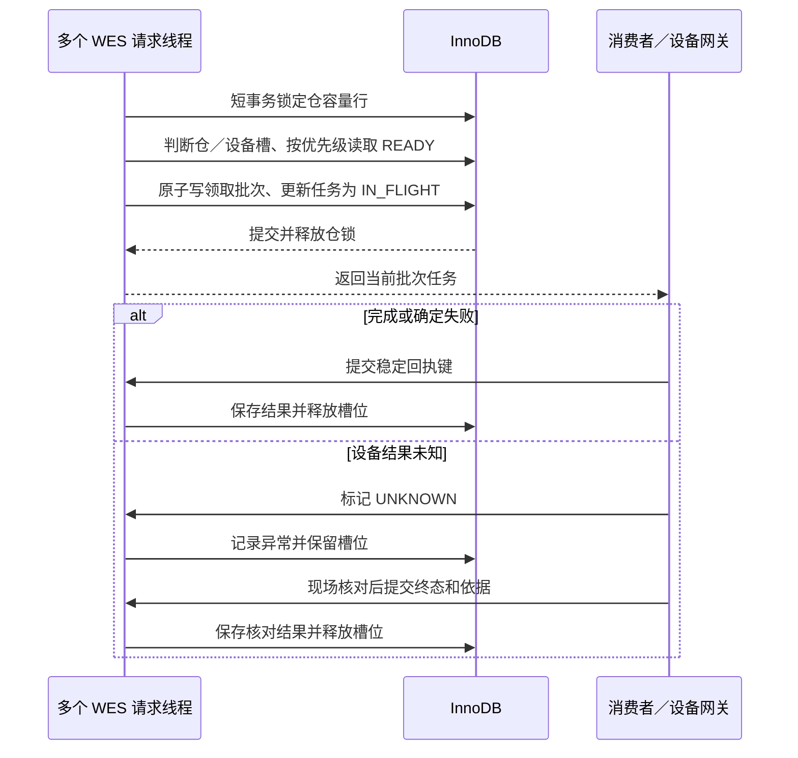

# 高并发、幂等与任务下发设计

## 现状与取舍

设计已考虑高并发、多线程消费、重复请求与排队上限。当前 Java WMS 已有库存版本校验，本阶段补充单据分配回执与 WES 持久化任务领取。数据库基线为 MySQL 5.7/InnoDB，业务锁在数据库内协调，适用于多个请求线程和多个服务实例。WCS 真实发令和自动送达交由后续阶段接入。

| 场景 | 当前保障 | 取舍 |
| --- | --- | --- |
| 多个线程分配同一出库单 | 先锁单据，按订单 ID 读取历史分配键。同键返回当前单据，新键冲突 | 老单若已分配且缺少回执，继续受原有状态机保护 |
| 不同订单争抢同一库存 | 保留库存版本校验，按库位、SKU、批次稳定排序，库存、单据、回执同事务 | 版本冲突回滚整单，调用方带同一键限次退避重试 |
| 多个线程领取同仓任务 | 在仓容量行上持短事务锁，检查仓和设备剩余槽后条件更新 READY | 不同仓可独立推进；单仓热点有锁等待，须压测 |
| 任务积压 | 按仓限制 READY 队列长度，满时返回 HTTP 429，已有入队键仍可读取 | 请求线程不阻塞等待队列有空间，调用方退避并加抖动 |
| 领取或回执丢失 | 领取保存成员；回执保存用途、目标状态和原因；键冲突拒绝 | 重放返回相同成员或任务的当前状态 |
| 设备无响应 | UNKNOWN 继续占仓库、设备槽；核对后才能终结释放 | 结果未知时禁止自动重新派单；无硬件“恰好一次”的保证 |

## 容量计算

每次成功领取的任务数上限：

```text
min(调用方请求数, 仓配置最大批量, 仓剩余在途槽, 设备剩余在途槽, READY 实际任务数)
```

- 在途定义为 IN_FLIGHT 或 UNKNOWN。成功、失败都释放容量，UNKNOWN 只有现场核对后才能解除。
- 排队和在途各自有上限。仓配置支持把任何一项设为 0，分别用于禁止新增、暂停下发或禁止形成新批次；设备上限 0 暂停该设备。缩小容量不会撤销已提交任务，只暂停新领取直到使用量下降。
- API 的单次请求范围是 1–100。业务仓、设备额度写入数据库。样例的仓总在途 16、设备在途 4、批量上限 8、待派 200 是演示值；真实设置应依据设备支持的并发指令数、安全在途距离、平均作业时长、仓 SLA 和数据库压力校准。
- 队列按优先级降序、同优先级按任务 ID 升序排序。跨仓并行、同仓短事务串行。在事务中完成容量判断、领取和回执落库，网络通信在事务结束后由调用方进行。
- 领取不到任何任务返回空数组且不保存领取键，可以继续轮询。同键已领取过任务时只读该批成员；调用方发令前再次核对任务状态，并使用稳定业务任务 ID 做网关侧去重。现阶段只允许一条任务记录被领取一次，失败后的重新计划需要业务方确认并创建新的任务键。



## 数据库与接口

- V2 迁移创建 wes_dispatch_capacity、wes_dispatch_device、wes_claim、wes_dispatch_task 和 wes_dispatch_event。唯一键分别覆盖仓级任务键、仓级领取键和任务级回执键。任务查询索引覆盖仓、状态、优先级、设备与批次。
- V3 建立 wms_allocation_receipt，一张出库单至多一个成功分配回执。开通前执行 V1、V2、V3，已有环境仅按顺序执行尚未应用的迁移。迁移沿用该分支现有手工执行方式。运维若事务内同时更新仓与设备容量，先锁仓容量行，再更新设备，保持统一锁顺序。

仓库 1 的演示容量：

```sql
INSERT INTO wes_dispatch_capacity (warehouse_id, max_ready, max_active, max_batch) VALUES (1, 200, 16, 8);
INSERT INTO wes_dispatch_device (warehouse_id, device_code, max_active) VALUES (1, 'station-01', 4);
```

| 方法与路径 | JSON 示例 | 结果 |
| --- | --- | --- |
| POST /api/wes/warehouses/1/tasks | {"taskKey":"pick:SO-42:1","priority":40} | 入队，返回任务／重放返回当前状态 |
| POST /api/wes/warehouses/1/claims | {"deviceCode":"station-01","claimKey":"worker-1:42","limit":8} | 领取至多 4 条；容量不足或暂无任务时可返回空数组 |
| POST /api/wes/warehouses/1/tasks/{taskId}/events | {"deviceCode":"station-01","claimKey":"worker-1:42","eventKey":"device-42:1","state":"UNKNOWN","reason":"响应超时"} | 暂停推进并保留槽，现场核对后用新键提交终态，附 reconciled:true 和核对原因 |
| POST /api/wms/outbound-orders/{id}/allocate | {"idempotencyKey":"oms:SO-42:allocate"} | 同订单同键仅预留一次，重放时返回当前单据状态 |

WES 返回通用 ApiResponse 对象。无仓／设备／任务返回 404，参数错误返回 400，键与内容冲突或状态非法返回 409，待派队列满返回 429。WMS 出库分配沿用现有 ApiResponse 错误契约。

## 分阶段代码和生产验收

1. **已实现，WMS 防重复分配。** 单据锁、库存版本校验、固定维度顺序和事务回执。验证同一订单八个请求并发仅预留一次。
2. **已实现，WES 并发领取。** MySQL 可恢复队列、四类限额、三个幂等键和 UNKNOWN 状态。验证十六线程、两台设备并发领取，检查唯一任务数、优先级及各层额度。
3. **后续，自动编排与适配器。** WMS 事务 Outbox 提供业务任务来源，转发和回执 Inbox 去重。网关接入时采用共享线程池与有界队列，批量领取前先检查本机可执行槽；饱和时暂停领取。限制外部调用超时和退避频率，不将网络 I/O 放入数据库事务。按指令 ID 与现场实物追踪恢复，未知任务进入核对队列。鉴权后分别授予任务生产、设备消费、异常核对权限。
4. **后续，容量验证与分区。** 增加每仓队列深度、最老任务龄、领取吞吐、数据库锁等待 P95/P99、在途量、未知量、回执重放率、429 率。根据现场分布同时压测突发订单、跨仓、单仓热点和网关断线。单仓锁变成瓶颈时，按执行区分片并设计从仓到区的容量配额；在替换锁实现前验证多实例下额度依然严格。任务与回执需制定保留期并在归档后继续满足重放窗口。

## 复验

常规验证使用 `mvn -B -C -ntp clean verify`。真实 MySQL 并发用例需在一次性测试库先执行 V1–V3，再设置 STONE_TEST_MYSQL_URL、STONE_TEST_MYSQL_USER、STONE_TEST_MYSQL_PASSWORD 后执行同一命令。用例会创建固定测试数据，使用空测试库重跑。集成验证证明给定并发场景下的一致性和限额；生产吞吐量仍由现场容量测试确定。
