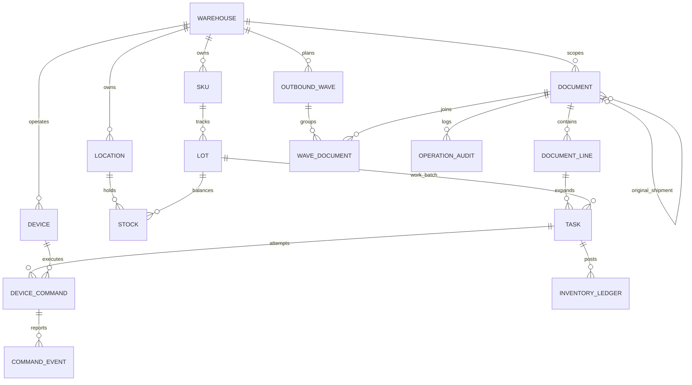

# 数据库设计

> 本文记录 WMS + WES + WCS 的目标设计与参考实现。后续开发以本分支的 Java WMS 工程为基础，接口和功能的当前实现进度以代码与测试为准。

[参考建表 SQL](warehouse-workflows-schema.sql) 对应全流程参考实现。参考实现以 H2 MySQL 模式初始化文件库，MySQL 部署按变更窗口执行 DDL。本分支现有 Java WMS 的数据库结构见 [V1 迁移](../src/main/resources/db/migration/V1__create_wms_core_tables.sql)。数量使用 BIGINT，批次日期使用 DATE，时间戳用于作业排队与审计；生产部署应统一连接、数据库和应用时区。

| 表 | 主键／关键业务键 | 业务字段与用途 |
| --- | --- | --- |
| warehouse | id；code 唯一 | 仓库档案和业务写锁 |
| sku | id；warehouse_id + code | 商品基本单位标识 |
| location | id；warehouse_id + code | STORAGE、PICK_FACE、QUARANTINE |
| lot | id；sku_id + batch_code | expires_on，可空 |
| stock | location_id + lot_id | on_hand、reserved；均为整数 |
| document | id；warehouse_id + kind + external_ref | kind、state、request_hash、source_document_id、created_at |
| document_line | id；document_id + line_no | SKU、可选批次、源位和目标位、数量 |
| outbound_wave | id；warehouse_id + code | priority、state、reason、created_at |
| wave_document | wave_id + document_id | sequence_no；草稿波次取消后保留关系 |
| task | id；按仓状态及单据索引 | 单据和明细、批次、源/目标、数量或账面快照、实盘、轮次和状态 |
| device | id；warehouse_id + code | 模式及启停状态 |
| device_command | id；task_id + attempt | device_id、state、created_at |
| command_event | command_id + event_key | 事件类型、数量、详情和时间 |
| inventory_ledger | id；task_id + location_id + reason | 仓、批次、两类增减、创建时间 |
| operation_audit | id；按 document_id + created_at 查询 | 业务动作、任务、依据及创建时间 |

## 约束、事务和索引

- 单事务写锁固定从 warehouse 开始。库存保持 0 ≤ reserved ≤ on_hand ≤ 1 万亿。新余额和首笔流水同事务创建。MySQL 5.7 的 CHECK 约束不作为依赖，服务内校验上限、非负与预留。
- 关联业务规则由锁内查询校验，包括同仓实体、商品和批次对应关系、唯一有效波次、设备单槽、按库位批次的盘点冻结。外键防止悬挂引用。客户端按 API 写入。
- 回执先校验命令状态和轮次，再以唯一事件键保存；回执、指令状态、任务、单据与库存可同事务提交。历史失败命令保留原状态。
- 任务队列以仓与状态查找，盘点范围以仓、批次、源位与状态过滤。指令按设备和状态检查槽位，波次成员的反向索引支持判断有效编组及优先级。
- 日结按 location_id、lot_id 对 delta_on_hand、delta_reserved 分别求和，核对 stock。同一任务不能对同一库位和账务原因重复记账。数据修复应走补偿动作并保留审计。

| 账务原因 | Δ on_hand | Δ reserved | 提交时点 |
| --- | ---: | ---: | --- |
| PUTAWAY | +q | 0 | 上架成功或现场确认已完成 |
| RESERVE | 0 | +q | 出库、补货、移库释放 |
| RELEASE | 0 | −q | 未执行取消或核对退拣后取消 |
| MOVE_OUT | −q | −q | 实物已离开源位，与 MOVE_IN 同事务 |
| MOVE_IN | +q | 0 | 实物已到目标位 |
| SHIP | −q | −q | 复核后确认发运 |
| COUNT_ADJUST | 实盘 − 账面 | 0 | 差异确认 |

生产扩展保留物理表迁移版本；按货主、处置状态和 LPN 扩充库存维度。与外部系统通信时增加 outbox_event（event_id、aggregate_id、payload、state、next_attempt_at）、inbox_event（source、event_id 唯一），设备侧增加现场位置、心跳及命令序列日志。部署升级前使用真实 MySQL 版本回归初建和增量迁移。
