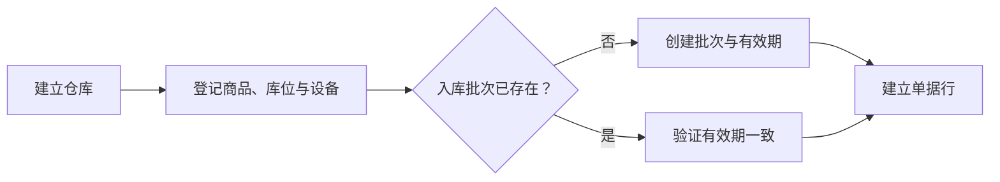
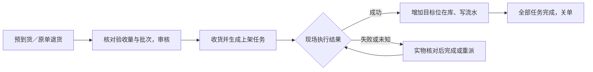
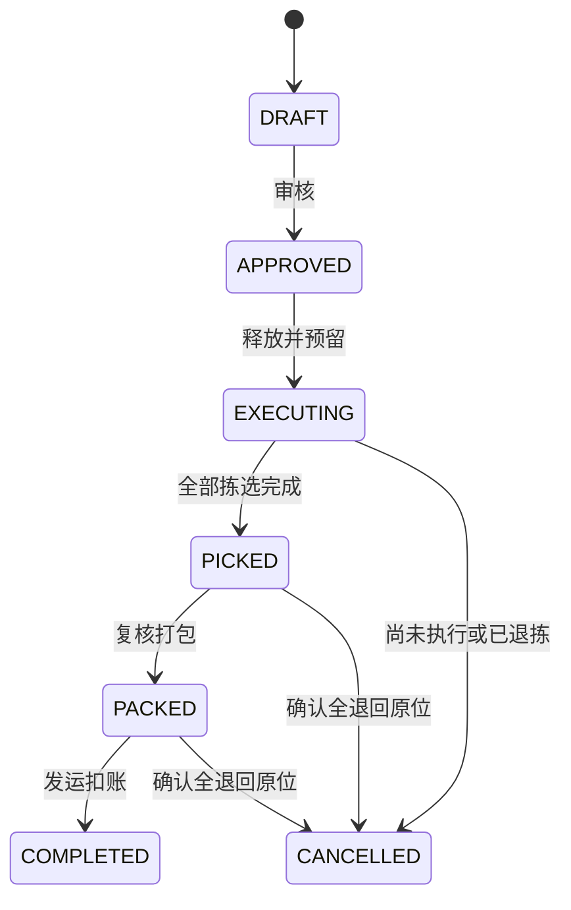
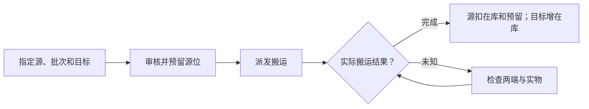
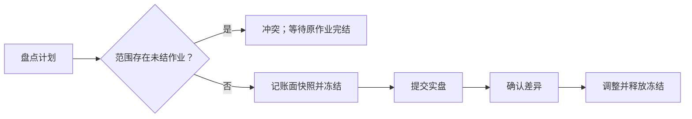
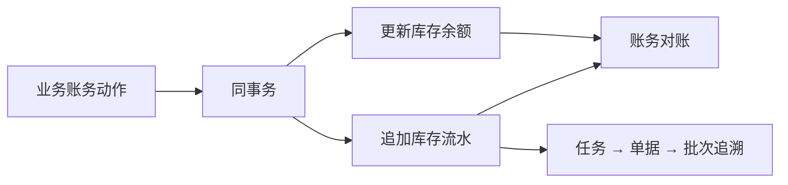
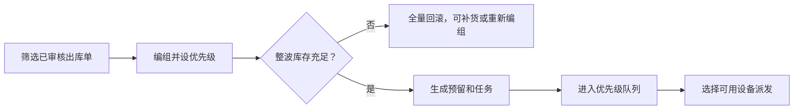
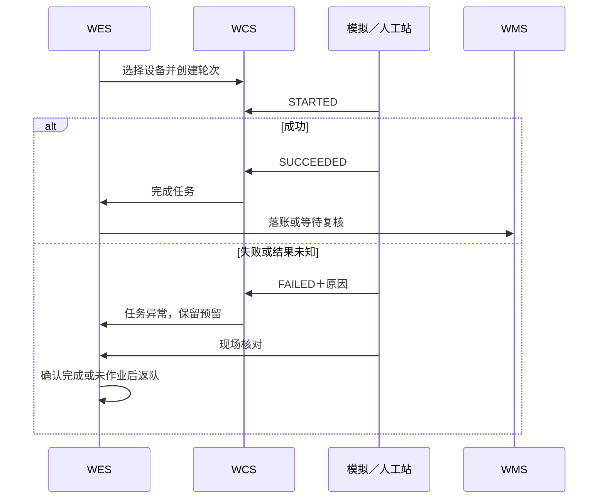

# 模块详细设计

接口、物理模型和事务约束见 [接口设计](api.md) 与 [数据库设计](database.md)。

## 1. 仓库、商品、库位和批次

**概设**：仓库是作业与数据隔离边界。库存由 SKU、批次和库位定位；存储、拣选和隔离库位各有用途。

**详设**：按仓登记 SKU、库位、工作站，编码统一大写、同仓同类唯一。禁止单据使用其他仓的商品、库位和设备。普通入库首次建批次并记录有效期；后续若填写日期需一致。无日期批次参与分配但排在有日期批次后。当前档案无删除，保证历史引用稳定。生产需增加库位容量、禁混规则、货主、单位换算、条码和在用状态检查。

- 数据：warehouse、sku、location、lot、device。
- 接口：仓库新增和列表、catalog、SKU／库位／设备新增。

## 2. 入库与销售退货

**概设**：仓库核对到货，复核批次和质量，审核后收货，上架成功才记账。销售退货关联原发运批次并留在隔离区。

**详设**：每行一个验收量与目标库位，审核后整单收货，按行产出上架任务。手工选定隔离位可隔离验收待判库存。销售退货须引用同仓已发运出库单，同批次累计退货量（包含草稿、排除已取消）不能超过实际发运量。退货一律进入隔离位。任务成功向目标位增加在库并写 PUTAWAY。最后任务落账后关单。当前整单收货；生产的 ASN 差异、超收阈值、质检单、隔离解冻、退供应商及报废需独立单据和审批链。

- 数据：document、document_line、lot、task、stock、inventory_ledger。
- 接口：kind=INBOUND/RETURN 建单，APPROVE、RECEIVE、CANCEL；上架回执复用 WCS 接口。

## 3. 出库、复核打包和发运

**概设**：审批通过的订单由 WES 单单或整波释放，WMS 预留库存，作业员拣选，复核员打包并确认发运交接。

**详设**：可指定批次、源位或自动分配。过滤隔离位、过期批和冻结位，FEFO 按有效期、批次编码、库位编码升序，无日期置后；到期当天（UTC）有效。单行跨库位或批次时拆任务，任意行不足整单回滚。派发与发运再次检查有效期。已拣实物线下暂存，账仍挂源位且维持预留；复核数量与批次后 PACK，按交接记录 SHIP 并同时扣在库和预留。全待派发可取消并释放；已拣后须核对所有已拣实物回原位才允许退拣取消。部分短拣、箱级、分批发运和承运面单需增加短拣、复核箱及发运明细。

- 数据：document、document_line、task、stock、inventory_ledger、operation_audit。
- 接口：APPROVE、RELEASE、PACK、SHIP、CANCEL、UNPICK_CANCEL。

## 4. 移库与补货

**概设**：移动同仓实物且保持仓级总在库不变。补货将存储库存补到前置拣选位。

**详设**：指定同仓不同源位/目标位和批次。补货限制 STORAGE → PICK_FACE。校验源可用量和目标盘点冻结后预留源位，确认成功时同事务 MOVE_OUT、MOVE_IN；失败保留预留并核对两端。反向搬运需新建作业单。生产扩展按拣货面低水位、队列需求、区容量生成补货，拣选任务等待所需补货实际完成；跨仓另设在途凭证并关联调拨出入库。

- 数据：document、document_line、task、stock、inventory_ledger。
- 接口：kind=TRANSFER/REPLENISH 建单，APPROVE、RELEASE、CANCEL。

## 5. 盘点和库存调整

**概设**：按库位加批次循环盘点，冻结范围保证账面快照和实物可比。观察量单独存储，经审核才改账。

**详设**：建计划时不填数量。释放时拒绝重叠盘点和活动任务，含已拣未发出库；快照账面量，允许零库存盘点。活动盘点阻止新上架、移入和预留影响该范围。回执允许实盘为零；最后实盘结束后仍冻结，ACCEPT_COUNT 时按实盘减账面调整并解除冻结；无差异不写流水。全待派发可取消。上线增加盲盘、复盘阈值、调整原因分类和双人确认。

- 数据：document、task.quantity、task.observed_quantity、stock、inventory_ledger。
- 接口：kind=COUNT、APPROVE、RELEASE、含实盘量的成功回执、ACCEPT_COUNT。

## 6. 库存、流水与运营查询

**概设**：余额是运营视图，流水记录数量增减，单据审计和回执提供来源证据。

**详设**：available 是在库减预留。实际可分配量另受隔离、日期、冻结约束。流水只追加；按 taskId 联查单据、库位批次、所有指令轮次及业务原因。运营对账以库位批次汇总流水并和余额比较。生产增加只读副本、异步导出、库龄和发运及时率；当前可查分页余额、流水、单据及任务。

- 数据：stock、inventory_ledger、operation_audit、command_event。
- 接口：按仓 GET inventory、ledger、documents，以及单据和任务明细。

## 7. WES 波次、队列和异常调度

**概设**：计划员按作业批次将同仓出库单编组，确定优先级并整波释放。班组长以工作站容量为约束安排执行。

**详设**：每波 1–50 张已审核出库单，优先级 0–100。单据只能属于一个有效波次。按成员提交顺序分配，任一单库存不足则回滚整波。草稿可取消并保留关联历史，释放后成员分别执行。队列按异常、执行中、待派发排序，同类内波次优先级降序，再按任务时间、ID。当前人工选择设备，每台一个槽；生产调度引入截单时刻、巷道、补货依赖、设备能力和老化防饥饿。

- 数据：outbound_wave、wave_document、task、operation_audit。
- 接口：仓内 waves、波次 RELEASE/CANCEL、仓内 tasks、dispatch、reconcile。

## 8. WCS 指令、回执与异常

**概设**：一次任务执行对应一个轮次和指令，WCS 记录设备原始结果，WES 在异常后核对实物并决定业务终态。

**详设**：同仓启用设备且无活动指令、无未处理失败，才允许派发。指令 SENT → STARTED → SUCCEEDED；SENT 或 STARTED 可转 FAILED，需写原因。相同指令及回执键、内容一致则重放，内容冲突和旧轮次晚到回执拒绝。失败保留预留、锁住设备槽；现场经核对确认为未作业才重新入队，确认已经完成则走正常账务，原失败记录保留。端点没有连接真实设备，作业台用模拟/人工回执。

上线边缘网关持久化指令键和状态，按站点和设备身份验签；命令包含设备、任务、轮次、来源、目的、载荷及截止时间。超时归类为未知，按设备状态和实物位置核对后再决定是否补发。急停、人员保护和互锁由现场控制系统负责。实机验收断连、堵塞、急停、重复信号、重启与恢复对账。

- 数据：device、device_command、command_event、task、operation_audit。
- 接口：设备启停、GET commands、POST events、POST reconcile。

