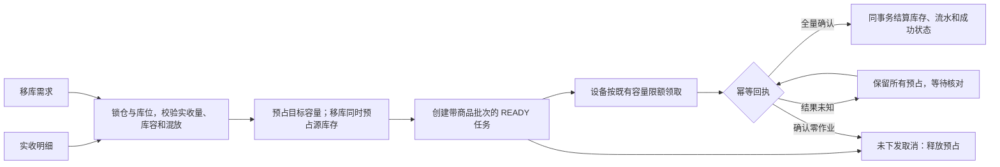

# 入库、移库与库存记账

## 业务规则

- 收货登记以仓库和上游实收明细键为幂等范围，保存 SKU、批次和实收量。实收量可以分给多个上架任务；已成功和未终结的任务合计不得超过实收量。取消与核对为零作业的失败释放可重新分派的额度。
- 库位容量使用商品基本单位件数。占用量为已在库数量加所有 READY、IN_FLIGHT、UNKNOWN 的待移入量。预占时同步校验实物库存和其他未完成任务的商品批次。ANY 允许混放，SAME_SKU 限同 SKU，SAME_BATCH 限同 SKU 同批次。目标库位由调用方指定。
- 移库同时预占源库存和目标容量。任务成功时，源位扣在库与预占，目标位增在库与可用，任务状态、回执及双边流水同事务提交。READY 可取消；失败须确认零作业，UNKNOWN 继续保留源库存和库容。部分完成先转 UNKNOWN，人工处理到全量完成或确认全部实物回到原状态后再核对结案。
- 整库位冻结仅在该位没有未结库存任务和源库存预占时开放，期间阻止新上架、移入、移出及已配置库位的出库预占。冻结按盘点键记录，旧键回放不会覆盖新冻结。库位冻结通过作业权限生效，库存的 frozen_qty 继续用于单独的质量冻结余额；本阶段不实施质量冻结、实盘审批与差异调整。
- 出库预占现在同事务追加 `OUTBOUND_RESERVE` 流水。旧出库单维持按指定库位批次分配。已预占出库的发运结算和取消释放、跨批自动分配仍需专门的出库闭环。



## 数据与并发

V4 新增库位策略、冻结历史、实收明细与库存作业载荷，并扩展回执实作数量及原库存流水。流水保留原有在库变化字段，额外记录可用、预占、冻结变动。任务按「任务 ID＋库位＋动作」防重复落账，出库预占按「出库行＋动作」防重。

库存任务先取得 WES 仓容量行锁，再按库位 ID 升序锁定源位与目标位。出库分配按相同库位顺序锁已配置库位，库存更新保留版本校验。冻结独立锁定单库位；进出该位的库存写入经同一行锁协调。按业务键重放请求和回执，库存、容量与幂等记录随事务成败一起提交。WES 暂时仍与 WMS 共享主库，设备 I/O 由领取方在提交后执行。

队列按生成列 priority_rank 与任务 ID 升序读联合索引，优先级高的先取、同优先级按 ID 先到先取。MySQL 5.7.44 的 500 条待派样例可用该索引直接按序领取。仓级热点锁、库存写入吞吐与设备端延迟仍应按现场订单分布压测。

## 启用与接口

新库按顺序应用 V1 至 V4；已有 V1–V3 的库应用 [V4 迁移](../src/main/resources/db/migration/V4__wire_inventory_work_and_ledger.sql)。按照 [WES 并发设计](concurrency-dispatch.md) 配置仓和设备容量。仓库启用库存作业前，用维护窗口录入已清点库位的容量和混放策略。示例：

```sql
INSERT INTO wms_work_location (warehouse_id, location_id, max_units, mix_policy)
VALUES (1, 10, 100, 'SAME_BATCH'), (1, 20, 200, 'ANY');
```

| 方法及路径 | 请求要点 |
| --- | --- |
| POST /api/wms/warehouses/1/receipt-lines | {"receiptKey":"ASN1:1","skuId":8,"lotNo":"L01","quantity":25} |
| POST /api/wms/warehouses/1/stock-work | 上架 {"taskKey":"ASN1:1:put-1","priority":10,"type":"PUTAWAY","receiptKey":"ASN1:1","skuId":8,"lotNo":"L01","destinationId":10,"quantity":12} |
| POST /api/wms/warehouses/1/stock-work | 移库使用 TRANSFER，提供 sourceId 和 destinationId，省略 receiptKey |
| GET /api/wms/warehouses/1/stock-work/{taskId} | 查询库存任务、商品批次和库存流水 |
| POST /api/wms/warehouses/1/stock-work/{taskId}/cancel | 取消 READY 任务，同一请求可以重放 |
| POST /api/wms/warehouses/1/locations/10/freeze | {"freezeKey":"COUNT-1","reason":"周期盘点"} |
| POST /api/wms/warehouses/1/locations/10/unfreeze | {"freezeKey":"COUNT-1"} |
| POST /api/wes/warehouses/1/claims | 沿用领取协议，库存任务额外返回 work 商品载荷 |
| POST /api/wes/warehouses/1/tasks/{taskId}/events | 成功填 completedQty 全量，失败填 0，UNKNOWN 可填当前观测量。核对提交用新事件键、reconciled:true 和依据 |

真实 MySQL 验证覆盖并发抢库位、同批及同商品混放策略、防超实收、并发回执去重、取消释放、旧冻结键重放、出库冻结拦截、移库双边账和失败回滚。运行方式见 [MySQL 复验](concurrency-dispatch.md#复验)。
